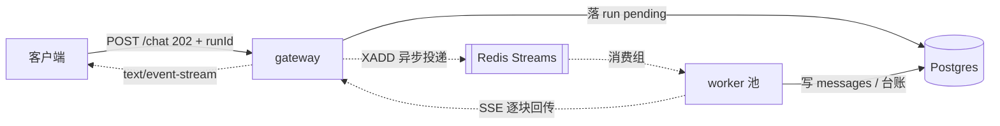

# README 七段式（示范样例 · 以 mini-koda 为例）

> 下面是把模板填满之后的样子。**七段一段都不能少，顺序也别调。**
> 读者预算是三分钟，而且他不打算 clone 下来跑——所以第一屏必须解决「这是什么」和「能不能跑」。
>
> 三个仓库各写一份，`agent-service` 和 `mini-multi-agent` 照这个形状改，
> 差别只在架构图和那三条设计决策。

---

# mini-koda

> Gateway 与 worker 池分离的 Agent 执行平台：接入层只鉴权、限流、落库、投递，
> 执行层从消息总线取活，同一用户的消息严格保序。

**个人项目 / 课程项目**（30 天 Agent 工程课的第二周里程碑，非生产系统）

demo：待补（3–5 分钟，脚本见本文末尾）

## 架构



形状分工：方块 = 服务，圆柱 = 存储，双方框 = 消息总线；**实线 = 同步，虚线 = 异步**。
全图 5 个节点，只画数据往哪流和边界在哪。

> 自检做过了：把这张图单独发给一位没做过 Agent 的后端同学，他答出了
> 「请求从 gateway 进、活在 worker 池干、状态存在 Postgres」——过。

## 快速开始

```bash
docker compose up -d                      # Postgres 5510 + Redis 6510
cp .env.example .env                      # 不填 key 也能跑，见下
MOCK=1 SELFTEST=1 pnpm start              # 起服务并自跑 5 项自检，跑完退出
```

没有 API key 也能完整跑通：`MOCK=1` 下模型调用走离线桩，基础设施走内存实现，
**不需要 Docker、不需要 key**。想连真环境就去掉 `MOCK=1` 并设置 `REDIS_URL` / `DATABASE_URL`，
跑的是同一份业务代码。

## 关键设计决策

1. **用 Redis Streams 而不是 Kafka。** 放弃了跨机房复制、无限期回溯和成熟的生态工具链，
   换来单个容器就能起、消费组语义够用、本地开发零依赖。这个项目的规模（峰值几十并发）
   离 Kafka 的适用区间还差两个数量级，上 Kafka 只会把「起不来」变成新的头号问题。
2. **顺序保证只做到「同一用户」这个粒度，不做全局有序。** 放弃了跨用户的因果序，
   换来可以按 `hash(userId)` 分片水平扩。全局有序意味着单点串行，那等于把整个 worker 池
   退化成一个消费者。
3. **幂等的最终裁判是数据库的唯一约束，不是应用层的先查后写。** 放弃了「查一下不存在再插入」
   那点直觉上的简单，换来并发下的正确性——先查后写在两个副本同时到达时必然双写，
   而这种 bug 在压测里不一定复现，在线上一定复现。

## 已知限制

- **这是学习项目，不是生产系统。** 所有数字都是本地单机、MOCK 模式下测的，没有做过真实压测。
- 没有做多租户：表里没有 `tenant_id`，限流是全局一个桶。
- 死信流只记录不告警，需要人工去看。
- worker 的并发度是写死的常量，没有按负载自适应。
- 没有鉴权之外的权限模型，工具白名单是配置里的静态列表。

## 目录导读

```text
src/
├── gateway/   接入层：鉴权、限流、落库、投递，不执行任何模型调用
├── worker/    执行层：消费循环、Agent 循环、SSE 回传
├── shared/    两边共用的类型、配置、日志、优雅停机
└── infra/     基础设施端口与两套实现（内存版 / 真实版），由环境变量选
```

读代码从 `src/worker/loop.ts` 开始，那是这个项目唯一值得细读的文件。

## 许可

MIT。

---

## 附：demo 视频脚本（3–5 分钟）

| 时间      | 讲什么                                                                                 |
| --------- | -------------------------------------------------------------------------------------- |
| 0:00–0:30 | 它是什么、解决什么问题。**不要念 README 第一行**，用自己的话说                         |
| 0:30–2:00 | 跑一遍 happy path：`MOCK=1 SELFTEST=1 pnpm start`，边跑边指着 5 项自检说每一项在验什么 |
| 2:00–3:30 | 讲一个最难的设计决策——这里选「租约续期为什么必须是原子的」，画一下脑裂发生的时序       |
| 3:30–4:00 | 已知限制和下一步。主动说出「没做过真实压测」比等人问出来好                             |

录之前把终端字号调大到能看清，把无关的 tab 关掉。**别配背景音乐。**
