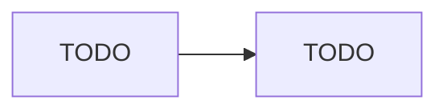

# README 模板（待填 · 七段）

> 复制这份到你仓库根目录的 `README.md`，逐段替换。**七段一段都不能少，顺序也别调。**
> 读者预算是三分钟，而且他不打算 clone 下来跑——所以第一屏必须解决「这是什么」和「能不能跑」。

---

# （项目名）

> TODO：一句话定位。它是什么 + 解决什么问题，一句话说完，不超过 40 字。
> 反例：「一个基于 Node.js 的 AI 项目」。正例：「Gateway 与 worker 池分离的 Agent 执行平台，
> 用消息总线解耦，保证同一用户的消息严格保序」。

> TODO：demo 视频链接放这里（3–5 分钟）。没录之前先留一行 `demo：待补`，别删掉这一行。

## 架构

> TODO：贴一段 Mermaid 源码。要求：
>
> - 节点不超过 8 个；
> - 只画「数据往哪流」和「边界在哪」，不画类图、不标依赖版本、不摆无关中间件；
> - 形状分工固定：方块 = 服务，圆柱 = 存储，双方框 = 消息总线；
> - 推到 GitHub 上确认真的渲染出来了（渲染失败时 GitHub 会原样打印这段源码）。



> 自检：把这张图单独发给一个做后端但没做过 Agent 的人，问他「请求从哪进、活在哪干、
> 状态存在哪」。他说得出来才算过。

## 快速开始

> TODO：**三条命令之内**跑起来。不是三段说明，是三行可以复制粘贴的命令。
> 超过三条说明有隐性依赖（要手动建库、要改配置、要先申请 key），先去把它消掉。

```bash
# TODO
```

> 自检：**在一个新建的空目录里照着自己写的敲一遍**。在你自己的工作目录里永远能跑起来，
> 因为环境变量、node 版本、镜像缓存都在。

## 关键设计决策

> TODO：三条，**每条都必须写出「放弃了什么」**。这一段是整份 README 里最值钱的部分，
> 因为它是唯一无法从模板抄来的内容，也是面试官挑追问的地方。
> 反例（功能列表）：「用了 Redis Streams 做消息总线」。
> 正例（决策）：「用 Redis Streams 而不是 Kafka，放弃了跨机房复制和无限回溯，
> 换来单机就能起、一个容器搞定运维」。

1. TODO：决策一 —— 放弃了什么
2. TODO：决策二 —— 放弃了什么
3. TODO：决策三 —— 放弃了什么

## 已知限制

> TODO：3–5 条。主动写出边界不是暴露短板，是同时证明自我认知和诚信；而且你先说了，
> 面试官就很难再拿它当把柄。**如果这是个学习项目，第一条就写清楚。**

- TODO
- TODO

## 目录导读

> TODO：只列读者需要知道的那几个目录，每个一句话说清它负责什么。
> 不要把 `node_modules`、`.github` 这种东西也列上。

```text
TODO
```

## 许可

> TODO：写清楚许可（本课的 lab 代码是 MIT）。没有许可等于保留全部权利，
> 别人连读都不敢读。
